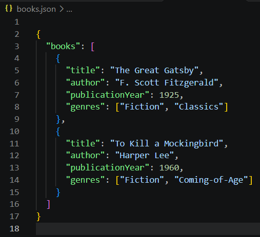
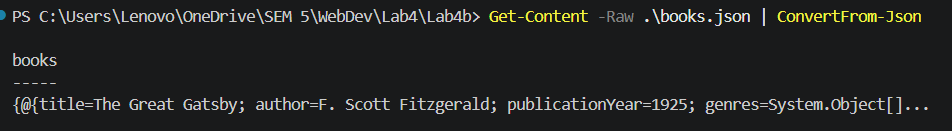
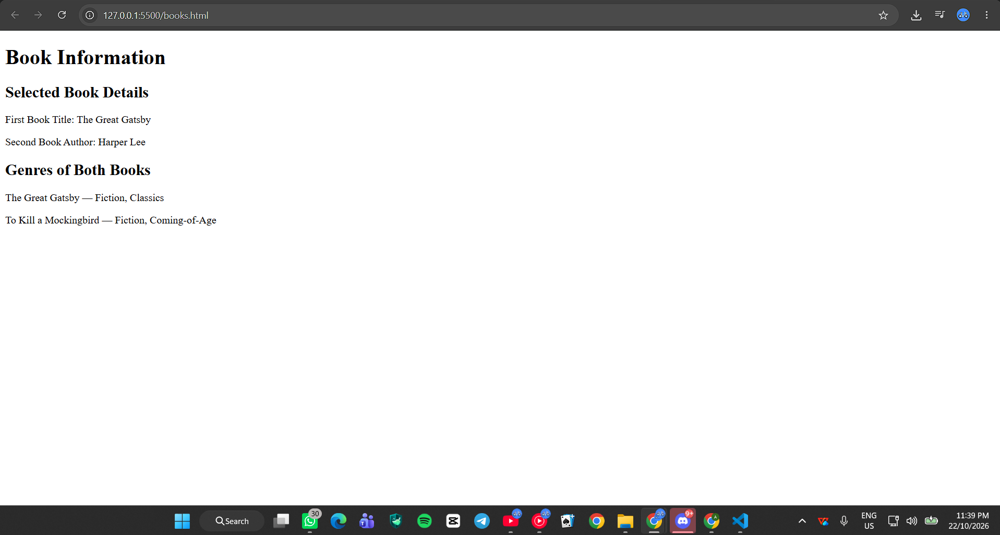
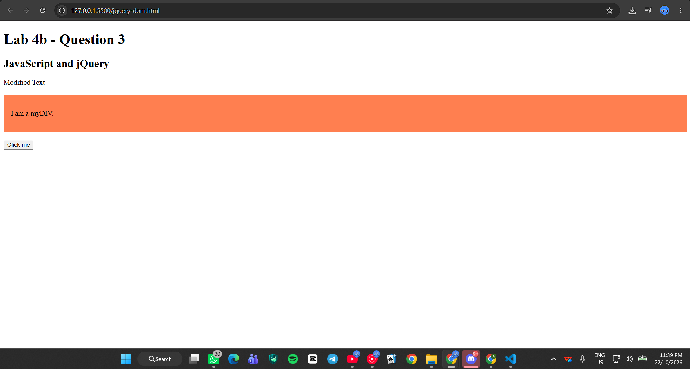
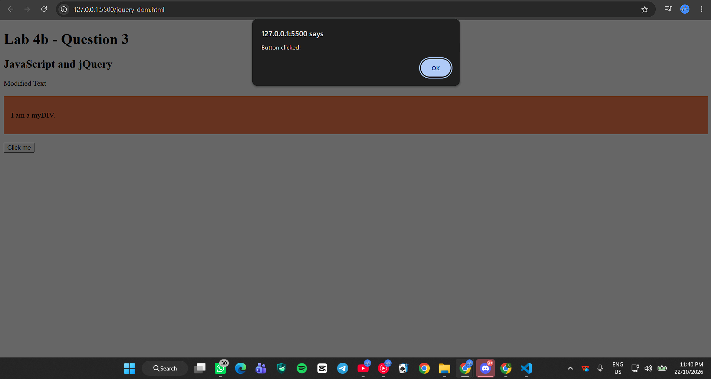

# BIC21203 Lab 4b – JSON and jQuery

**Name:** AHMAD FAUZI BIN SUYUTI  
**Matric Number:** AI240082  
**Course:** BIC21203 Web Development  
**Lab:** Lab 4b – Client-Side Scripting (JSON and jQuery)

## Introduction
This lab introduces JSON data handling and jQuery. It demonstrates how JavaScript retrieves and displays book information. It also demonstrates how jQuery changes HTML elements.

## Question 1 – Create and Structure JSON Data
I created a books.json file containing two books. Each book includes its title, author, publication year, and genres.

## Question 2 – Retrieve and Display JSON Data
I used the fetch() method to retrieve JSON data. The webpage displays selected information about both books. It also handles errors when loading the JSON file.

## Question 3 – Compare Native JavaScript and jQuery
I used jQuery to change text and apply CSS. I also created a button that displays an alert.

## How to Run
1. Download the project files from GitHub.
2. Open the Lab4b folder using Visual Studio Code.
3. Install the Live Server extension if needed.
4. Open books.html using Live Server for Question 2.
5. Open jquery-dom.html using Live Server for Question 3.
6. Make sure an internet connection is available for jQuery.

## Screenshots

### Question 1 – JSON Data

### Question 1 – JSON Validation

### Question 2 – Display JSON Data

### Question 3 – jQuery Styling

### Question 3 – Button Click

